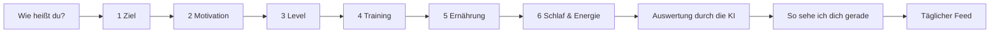

# Onboarding-Fragebogen

Zweiter Baustein im [[MVP-Fortschritt]]. Grundidee aus [[Kernmechanik#1. Onboarding]] und [[App-Gesamtübersicht (Original)]]: Ein Einstiegs-Fragebogen, der die App direkt personalisiert (Ziel, aktuelles Level, Ausgangssituation). Die Antworten landen beim [[Nutzer]].

Alles hier haben Phillip und Claude am 2026-10-11 gemeinsam festgelegt, Frage für Frage. Abgenommenes Mockup: [Onboarding-Entwurf](https://claude.ai/artifact/JdmD7NVMayHub5fh3MN9Xn).

## Überarbeitung 2026-10-18 (in Arbeit)

Phillip hat das Onboarding mit dem echten Coach getestet: Bis zum Feed hat er rund 6 Minuten geschrieben. Die Fragen sind zu lang und zu komplex. Beschluss (Phillip, 2026-10-18): **Variante B ausprobieren.** Pro Frage 3–4 Antworten zum Antippen (Mehrfachauswahl möglich) plus ein freiwilliges Feld für eigene Worte. Die neuen Fragen werden gerade gemeinsam Frage für Frage festgelegt. Danach kommt der [[Täglicher Check-in]] dran, der für den täglichen Gebrauch ebenfalls zu lang ist.

### Neue Fragen (beschlossen)

1. **Ziel** (Phillip, 2026-10-18): „Was ist dein Ziel, und was willst du dafür vor allem verändern?“
   - Antippen (mehrere möglich): Fitter und stärker werden · Mehr Energie im Alltag · Mental stärker werden und Dinge durchziehen · Mich wohler in meiner Haut fühlen
   - Feld „Dein Ziel in einem Satz“ (z. B. „Bis Sommer 8 kg weniger und wieder Spaß am Sport“). **Pflicht**, weil der Coach das Ziel ständig braucht. Alle anderen Felder sind freiwillig.

## Prinzip

1. **Antworten in eigenen Worten.** Freitext, keine Antwortknöpfe. Damit hebt sich die App direkt ab und passt sich vom ersten Moment an genau an den Nutzer an.
2. **Feste Fragen für alle, Auswertung am Ende durch die KI.** Alle bekommen dieselben Fragen in derselben Reihenfolge, ohne Nachfragen. Am Ende wertet die KI alle Antworten auf einmal aus.
3. **Am Ende eine kurze Zusammenfassung.** „So sehe ich dich gerade“ in 2–3 Sätzen, noch ohne Tipps. Der Nutzer soll sofort ein persönliches Gefühl haben und merken, wie individuell mit ihm gearbeitet wird.
4. **6 Fragen:** Ziel, Motivation, Level, Training, Ernährung sowie Schlaf & Energie. Schlaf gehört zur Energie und ist deshalb eine gemeinsame Frage, wie im täglichen Check-in.
5. **Stil:** besondere Fragen, die zum Nachdenken anregen. Keine Standard-Abfragen.

## Ablauf

## Die Fragen

| Nr. | Thema | Frage | Feld in [[Nutzer]] |
|---|---|---|---|
| 1 | Ziel | Wie stellst du dir dein Leben vor, wenn du endlich glücklich bist und im Inneren Erfolg spürst? Was machst du dann anders als heute? | `ziel` |
| 2 | Motivation | Was ist der wahre Grund, warum du dich und dein Leben jetzt verändern willst? | `motivation` |
| 3 | Level | Wie würde jemand, der dich gut kennt, deine Essgewohnheiten, deinen Sport, deine Energie, dein Verhalten und mögliche positive Veränderungen in letzter Zeit beschreiben? | `level` |
| 4 | Training | Wo bist du dir bei deinem Training und deiner körperlichen Verfassung gerade unsicher, oder was ist dir noch unklar? | `training` |
| 5 | Ernährung | Wie fühlst du dich gerade mit deiner Ernährung, und wo bist du dir unsicher, ob sie dir wirklich guttut? | `ernaehrung` |
| 6 | Schlaf & Energie | Wie erholt fühlst du dich morgens wirklich, und wann im Alltag merkst du, dass dir Energie fehlt? | `schlaf_energie` |

## Bildschirme

- **Wie heißt du?** (neu seit 2026-10-13, mit Phillip festgelegt): Einmal ganz am Anfang. Klein „Bevor wir starten“, darunter „Wie heißt du?“ und „So spricht dich dein Coach an.“, ein einzeiliges Feld „Dein Vorname“, Button „Weiter“ (erst wenn etwas drinsteht). Gespeichert als `name` in [[Nutzer]]; der Coach spricht den Nutzer damit an, siehe [[Coach-Stil]].
- **Fragen 1–6:** oben ein Fortschrittsbalken in 6 Teilen und klein „Frage X von 6 · Thema“, darunter die Frage und ein großes Textfeld („Schreib in deinen eigenen Worten …“). Button „Weiter“, bei Frage 6 „Fertig“. Weiter geht es erst, wenn etwas eingetragen ist. Ein Pfeil führt zurück (von Frage 1 zur Namensfrage), die bisherige Antwort bleibt erhalten.
- **Auswertung:** „Ich lese deine Antworten …“ während die KI arbeitet.
- **So sehe ich dich gerade:** die Zusammenfassung der KI (Feld `zusammenfassung`), Button „Los geht's“.

Solange die KI noch nicht angebunden ist (es fehlt der KI-Schlüssel und das Backend, siehe [[Offene Fragen#Onboarding]]), steht an der Stelle der Zusammenfassung: „Deine Antworten sind gespeichert. Deine persönliche Auswertung kommt bald, sobald dein Coach freigeschaltet ist.“

## Wie die KI die Antworten nutzt

Die sechs Antworten gehen zusammen an die KI. Sie schreibt daraus die Zusammenfassung und bekommt sie später bei jeder [[Kernmechanik#3. KI-Antwort|KI-Antwort]] als Profil mit. Die Motivation (Frage 2) kann sie nutzen, um jemanden an seinen eigenen Grund zu erinnern, wenn er stagniert.

## Weiter

- Code: [[App-Code]]
- Nächster Baustein: [[Kernmechanik#2. Täglicher Feed (Kernbildschirm)|Täglicher Feed]]
- Offene Punkte: [[Offene Fragen#Onboarding]]
