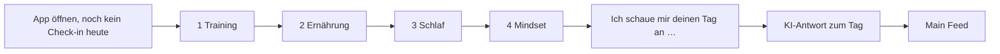

# Täglicher Check-in

## Überarbeitung 2026-10-18

Phillip hat den Check-in mit dem echten Coach getestet: Für den täglichen Gebrauch ist er zu lang und zu komplex. Beschluss (Phillip, 2026-10-18): **Variante B**, alles auf einem Bildschirm. Pro Bereich eine schnelle Antwort zum Antippen, darunter ein freiwilliges Feld „Was war heute besonders?“ (ca. 30 Sekunden). Antworten pro Zeile (Phillip „ja programmier erstmal so“, 2026-10-18), je Zeile eine antippen, alle Zeilen nötig:

- **Training:** Gut trainiert · Lief zäh · Pause, gut erholt · Pause, eher unproduktiv
- **Ernährung:** Strukturiert gegessen · Heißhunger gehabt · Unregelmäßig gegessen · Viel Fast Food
- **Schlaf:** Gut geschlafen · Schlecht eingeschlafen · Nachts wach gewesen · Zu kurz geschlafen
- **Energie:** Hoch · Mittel · Niedrig (eigene Zeile statt bei Schlaf/Mindset mitzulaufen)
- **Mindset:** Alles durchgezogen · Vor etwas gedrückt · Kaum Motivation
- Darunter freiwillig: „Was war heute besonders?“

Die tägliche KI-Umformulierung der Fragen entfällt; persönlich wird es über die Coach-Antwort. Gespeichert werden zusätzlich `energie` und `notiz`. Stand: fest in der App seit 18.10.2026 (PR #39).

Dritter Baustein im [[MVP-Fortschritt]] (Grundidee: [[Kernmechanik#2. Täglicher Feed (Kernbildschirm)]]). Alles hier haben Phillip und Claude am 2026-10-12 gemeinsam festgelegt. Abgenommenes Mockup: [Feed-Entwurf](https://claude.ai/artifact/FuJV2yDGQ8JPzLb5TtFakt).

### Aufbau und Design (18.10.2026)

Phillip fand den ersten Bildschirm unsortiert. Gewählt wurde Variante B, „Karten-Liste“, im dunklen Stil (siehe [[Design]]):
- Jeder Bereich ist eine eigene Karte mit Symbol. Es ist immer nur eine Karte offen und zeigt ihre Frage, z. B. „Wie lief dein Training?“, mit den Antworten zum Antippen.
- Nach dem Tippen klappt die Karte zu, zeigt die Antwort mit goldenem Haken, und die nächste offene Karte geht auf. Eine Karte lässt sich zum Ändern wieder antippen.
- Oben rechts zeigt ein goldener Ring „x von 5“. „Absenden“ wird golden, sobald alles beantwortet ist.
- Entwurf mit allen Varianten: https://claude.ai/artifact/NWJnSZaEC6HZjMTyWD89RU

## Prinzip

1. **Ziel der Fragen:** speziell und individuell, mit wenig Aufwand. Sie sprechen echte Probleme an, damit der Nutzer merkt, dass er schreibt, was ihm wichtig ist und wo er Hilfe braucht.
2. **Die KI passt die Fragen jeden Tag an den Nutzer an**, mit seinen [[Onboarding-Fragebogen|Onboarding-Antworten]] und den letzten Tagen. Grundlage sind feste Leitfragen (unten).
3. **Jeden Tag alle Bereiche:** 4 kurze Fragen zu Training, Ernährung, Schlaf und Mindset. Energie fragt die KI bei Schlaf oder Mindset mit ab. Mindset heißt hier: mental stärker werden und Dinge durchziehen, vor denen man sich früher gedrückt hat.
4. **Eine Frage nach der anderen**, wie im Onboarding. Fühlt sich wie ein Gespräch an.
6. **Kommt automatisch** (Phillip, 2026-10-12): Beim ersten Öffnen der App am Tag erscheint der Check-in von selbst, wie das Onboarding, ohne Knopf zum Starten. Erst wenn er beantwortet ist, öffnet sich der [[Main Feed]], zugeschnitten auf diesen Tag.
5. **Eine KI-Antwort nach allen 4 Fragen.** Die KI schaut auf den ganzen Tag, erkennt Zusammenhänge zwischen den Bereichen (z. B. schlecht geschlafen und deshalb Heißhunger) und gibt 1–2 konkrete Tipps, im festgelegten [[Coach-Stil]]. Dabei vergibt sie intern die Bewertung für den [[Fortschritts-Verlauf]].

## Leitfragen

| Bereich | Leitfrage | Feld in [[Check-ins]] |
|---|---|---|
| Training | Wie war dein Training heute, was lief gut und was nicht? Und falls du heute nicht trainiert hast: Hast du dich wirklich erholt oder eher unproduktiv gefühlt? | `antwort_training` |
| Ernährung | Hast du heute strukturiert und ohne Verlangen gegessen? Oder was lief bei deiner Ernährung heute nicht so gut? | `antwort_ernaehrung` |
| Schlaf | Hattest du Probleme beim Ein- oder Durchschlafen? Und wenn ja, was glaubst du, war der Auslöser? | `antwort_schlaf` |
| Mindset | Gab es heute etwas, wovor du dich aus fehlender Motivation gedrückt hast? | `antwort_mindset` |

Beispiel, wie die KI eine Leitfrage persönlich macht: „Du wolltest wissen, ob dein Training dich weiterbringt. Wie war dein Training heute …“

## Ablauf

## Stand im Code

- Programmiert am 2026-10-12, siehe [[App-Code]].
- Solange die KI nicht angebunden ist, zeigt der Check-in die Leitfragen ohne persönlichen Bezug, speichert die Antworten und zeigt statt der KI-Antwort: „Deine Antworten sind gespeichert. Sobald dein Coach freigeschaltet ist, bekommst du hier jeden Tag eine persönliche Antwort zu deinem Tag.“
- Ein Check-in pro Tag. Er öffnet sich automatisch, solange er für heute fehlt, und hat keinen Schließen-Knopf. Danach zeigt der [[Main Feed]] die Antwort des Coaches zum Tag. Auch direkt nach dem Onboarding folgt am selben Tag der Check-in.

## Weiter

- Startseite mit Gewichtsanalyse: [[Main Feed]]
- Offene Punkte: [[Offene Fragen]]
